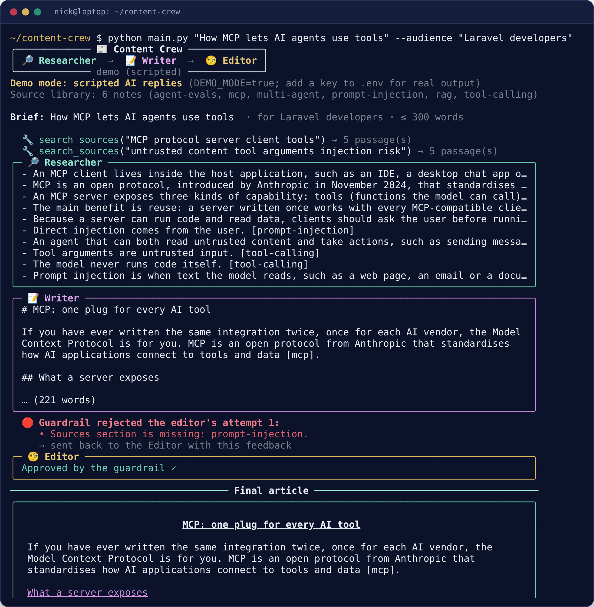

# 📰 Content Crew

> **Day 15 of [30 Days of AI Agents](https://github.com/obiokoye)**: three CrewAI agents (Researcher, Writer, Editor) turn a topic into a short, sourced article, and a plain-Python guardrail checks the Editor's work before it's accepted.




## What it shows

- **Multi-agent orchestration with CrewAI**: three agents, each with a role, goal and backstory, run as a sequential pipeline. Each `Task` has an `expected_output`, and `context=[...]` passes one agent's output to the next.
- **Narrow tools per agent**: only the Researcher gets tools (`search_sources`, `read_source`), and they're read-only and limited to a local `sources/` folder.
- **Grounded writing with citations**: every fact carries a source id like `[mcp]`, and the final article ends with a Sources list.
- **Code guardrails on agent output**: `check_article()` checks that citations point at real sources, every cited source is listed, the article fits the word limit, banned hype words are gone and an `EDITS:` list is present. If any check fails, CrewAI sends the problems back to the Editor (up to 2 retries).
- **Swappable providers**: Gemini, Groq, OpenAI or Anthropic through CrewAI's OpenAI-compatible client. Switch with one `.env` value.
- **Demo mode and offline tests**: a scripted `BaseLLM` plays all three agents, so real CrewAI runs end to end with no API key, in the terminal and in CI.

## Quick start

```bash
git clone https://github.com/obiokoye/content-crew.git
cd content-crew
python -m venv .venv && source .venv/bin/activate
pip install -r requirements.txt
cp .env.example .env    # add a free Gemini key from https://aistudio.google.com/apikey (or leave it empty for demo mode)
python main.py "How MCP lets AI agents use tools" --audience "Laravel developers"
```

Run `python main.py` with no topic to pick from the demo topics. Options: `--audience`, `--words` (default 300), `--sources` (folder of `.md` notes), `--out` (default `output/`). The final article is saved as Markdown in `output/`.

### Windows

CrewAI supports Python 3.10 to 3.13, so install **Python 3.12 or 3.13** (not 3.14) from [python.org](https://www.python.org/downloads/) and tick "Add python.exe to PATH".

```bat
git clone https://github.com/obiokoye/content-crew.git
cd content-crew
py -3.12 -m venv .venv
.venv\Scripts\activate
pip install -r requirements.txt
copy .env.example .env
python main.py "How MCP lets AI agents use tools"
```

Use Windows Terminal for the emoji and colours.

## Demo mode

With `DEMO_MODE=true`, or when the selected provider has no key, the app prints **"Demo mode: scripted AI replies"** and uses `ScriptedLLM` (`content_crew/demo.py`). CrewAI itself runs for real: same prompts, same tool loop, same guardrail. Only the model's replies are scripted:

- The Researcher's tool calls are scripted, but its notes are built from what the real `search_sources` tool returns.
- The Writer has pre-written drafts for three demo topics (MCP, multi-agent crews, RAG), each with one hype word left in on purpose. Other topics get a draft assembled from the notes.
- The Editor's first attempt leaves one source out of the Sources list, so you can watch the guardrail reject it and the retry fix it.

`DEMO_DELAY` (default `0.8` seconds per reply) makes a demo run look like a real one. Set it to `0` for instant runs.

## Switching providers

| `LLM_PROVIDER` | Key variable        | Default model             | Free tier |
|----------------|---------------------|---------------------------|-----------|
| `gemini`       | `GEMINI_API_KEY`    | `gemini-2.5-flash`        | ✅ |
| `groq`         | `GROQ_API_KEY`      | `llama-3.3-70b-versatile` | ✅ |
| `openai`       | `OPENAI_API_KEY`    | `gpt-4o-mini`             | ❌ |
| `anthropic`    | `ANTHROPIC_API_KEY` | `claude-haiku-4-5`        | ❌ |

Override the model with `LLM_MODEL=...`. A real run makes about 6 to 10 model calls (three agents plus tool steps plus any guardrail retries).

## Project structure

```text
content_crew/
  crew.py         # agents, tasks, sequential crew, guardrail wiring
  tools.py        # search_sources + read_source (CrewAI BaseTool, read-only)
  knowledge.py    # loads sources/*.md and does keyword search
  guardrails.py   # parse the Editor's output + check_article()
  config.py       # providers, demo-mode detection, LLM factory
  demo.py         # ScriptedLLM used by demo mode and the tests
sources/          # the trusted source library (sample notes on AI agent topics)
main.py           # Rich terminal UI
tests/            # pytest, no network or API key needed
```

## How to extend

- **Use your own sources**: drop Markdown files into `sources/` (or point `--sources` at another folder). The file name becomes the citation id.
- **Add a check**: add a rule to `check_article()` in `guardrails.py`, for example "must mention the audience", and add a test.
- **Add an agent**: create an `Agent` in `build_agents()` and a `Task` in `build_tasks()` with `context=[...]`, for example an SEO agent that writes a meta description after the Editor.
- **Give the Researcher the web**: write a new `BaseTool` that calls a search API. Treat what it returns as untrusted data (see LEARN.md).

## Run tests

```bash
pytest -q
```

New to Python or CrewAI? See **[LEARN.md](LEARN.md)**, which walks through this codebase in Laravel terms.

---

MIT © Nicholas Okoye
